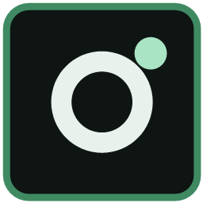

<p align="center">
  
</p>

<h1 align="center">Ясно SEO</h1>

<p align="center">
  Комплект SEO инструменти, който работи на твоя компютър, с интерфейс, удобен за очите:<br>
  тъмен фон, едър текст, висок контраст и карти вместо гъсти таблици.<br>
  Облечен в киберпънк тема с японски и нинджа акценти. Отваря се на <b>http://yasno.seo.localhost</b>.
</p>

---

## Съдържание

1. [Какво прави](#какво-прави)
2. [Какво ти трябва](#какво-ти-трябва)
3. [Инсталиране стъпка по стъпка](#инсталиране-стъпка-по-стъпка)
4. [Първо пускане](#първо-пускане)
5. [Инсталиране с Docker (по желание)](#инсталиране-с-docker-по-желание)
6. [Настройка на SerpApi (по желание)](#настройка-на-serpapi-по-желание)
7. [Настройка на Google Search Console (по желание)](#настройка-на-google-search-console-по-желание)
8. [Автоматични проверки и пускане с Windows](#автоматични-проверки-и-пускане-с-windows)
9. [Къде се пазят данните](#къде-се-пазят-данните)
10. [Обновяване](#обновяване)
11. [Проблеми и решения](#проблеми-и-решения)
12. [Премахване](#премахване)
13. [За разработчици](#за-разработчици)
14. [Лиценз](#лиценз)

---

## Какво прави

| Раздел | Какво прави | Нужно ли е нещо външно? |
|---|---|---|
| **Одит на сайт** | Обхожда сайта като Google и намира над 25 вида проблема: счупени линкове и картинки, липсващи заглавия и описания, пренасочвания, бавни страници, тежки картинки, липсващ sitemap и др. Всеки проблем идва с обяснение „защо е важно“ и „как да се оправи“. Има изтегляне в CSV за Excel. | Не |
| **Позиции в Google** | На кое място излиза сайтът ти за дадени думи и как се променя с времето. За всяка дума показва първите 10 в Google с техните заглавия, H1, подзаглавия и брой думи и ги сравнява с твоята страница (виж [по-долу](#сравнение-с-първите-10-в-google)). | Search Console (безплатно) **или** SerpApi |
| **Search Console** | Кликове, импресии, CTR и средна позиция от Google. „Възможности“: думи почти на първа страница. Обратни линкове от файл, изтеглен от Search Console, с нови и изгубени линкове. | Google Search Console |
| **Линк билдинг** | Намира сайтове по твоята тема, от които може да получиш линк, търси имейли за контакт, води статус и проверява дали полученият линк наистина е там. | SerpApi |

### Сравнение с първите 10 в Google

При проверка през SerpApi под всяка дума има бутон **„Първите 10 в Google: заглавия, H1 и сравнение“**. Като го отвориш, приложението отваря всеки от резултатите и показва:

- **заглавие (title), H1 и мета описание**, с дължините им;
- **подзаглавията H2**: темите, които страницата покрива;
- брой думи, H2/H3, **структурирани данни** (Article, FAQPage…), дата на публикуване или обновяване, оценка ★, картинки, видео, таблици, раздел с въпроси, линкове и време за отговор;
- **къде е ключовата дума:** в заглавието, H1, адреса и описанието, като ✔ (цялата), ◐ (частично) или ✖ (липсва), и колко пъти се среща точната фраза.

Отгоре има таблица **„Твоята страница срещу първите 10“** и конкретни съвети какво да подобриш. Ако сайтът ти се класира, страницата ти се зарежда сама. Ако не, въвеждаш адреса ѝ и натискаш **„Сравни“**.

Добре е да знаеш:
- Не струва допълнителни заявки в SerpApi: страниците се отварят директно.
- Някои сайтове спират роботи (код 403). Тогава пише, че страницата не може да се отвори.
- Понякога Google дава само домейна на резултата, не точната страница. Такива резултати са отбелязани с ℹ и **не влизат в сравнението**. Проверките отпреди тази версия често имат такива адреси: натисни **„Провери сега“**, за да се запишат точните.
- Всеки преглед се пази 6 часа в паметта, за да не се товарят чуждите сайтове. На диска не се записва нищо.
- Обратните линкове и авторитетът на сайта не се виждат оттук, а често решават класирането.

Всичко работи **само на твоя компютър**. Приложението не е достъпно от интернет или от други устройства в мрежата.

---

## Какво ти трябва

- **Windows 10 или 11.** Работи и на macOS и Linux, но иконата на десктопа и пускането с компютъра са само за Windows.
- **Node.js версия 20 или по-нова.** Това е безплатната програма, която „движи“ приложението.
  Ако вече ползваш Docker, Node.js не ти трябва: виж [Инсталиране с Docker](#инсталиране-с-docker-по-желание).
- Около **100 MB** свободно място.
- Интернет връзка.

---

## Инсталиране стъпка по стъпка

### Стъпка 1: Инсталирай Node.js

1. Отвори **https://nodejs.org**.
2. Натисни големия зелен бутон **„LTS“** и свали инсталатора.
3. Пусни го и натискай **Next** до края. Настройките по подразбиране са наред.
4. Провери дали е минало успешно:
   - Натисни клавиша **Windows**, напиши **cmd** и натисни **Enter**.
   - В черния прозорец напиши `node -v` и натисни **Enter**.
   - Трябва да видиш нещо като `v22.11.0`. Ако пише „not recognized“, рестартирай компютъра и опитай пак.

### Стъпка 2: Свали приложението

**Вариант А: без git (по-лесно)**

1. В горната част на тази страница в GitHub натисни зеления бутон **„Code“** → **„Download ZIP“**.
2. Разархивирай файла в папка по твой избор, например `C:\Users\ТвоетоИме\yasno-seo`.

   > ⚠ Пътят до папката трябва да е **на латиница**, без кирилица. Иначе пускането с Windows няма да работи.

**Вариант Б: с git**

```
git clone https://github.com/zooninja/yasno-seo.git
```

### Стъпка 3: Инсталирай нужните библиотеки

1. Отвори папката на приложението във File Explorer.
2. Кликни в адресната лента горе, напиши **cmd** и натисни **Enter**. Отваря се черен прозорец, вече в правилната папка.
3. Напиши:
   ```
   npm install
   ```
   и изчакай да приключи (около минута).

### Стъпка 4: Сложи икона на десктопа

В същия черен прозорец напиши:

```
npm run shortcut
```

На десктопа се появява икона **„Ясно SEO“**. Готово, черният прозорец вече може да се затвори.

---

## Първо пускане

1. Кликни два пъти на иконата **„Ясно SEO“** на десктопа.
2. Приложението тръгва скрито във фонов режим и се отваря в браузъра на адрес **http://yasno.seo.localhost**.
   Името работи без настройка: Chrome, Edge и Firefox сами насочват всеки адрес, завършващ на `.localhost`, към твоя компютър. Ако порт 80 е зает от друга програма, адресът е **http://yasno.seo.localhost:4321**. Старият адрес http://localhost:4321 също работи и прехвърля към новия.
3. Пробвай веднага **„Одит на сайт“**: въведи адреса на твоя сайт и натисни **„Започни одита“**. За него не е нужна никаква настройка.

**Размер на текста:** бутоните **A−** и **A+** горе вдясно. Изборът се помни.

**Външен вид:** тъмна киберпънк тема в зелено и синьо с японски надписи (監査 „одит“, 順位 „позиции“, 設定 „настройки“…) и нинджа мотиви: сюрикен за лого, катана под заглавията, нинджа в долния ъгъл. Украсата никога не носи смисъл сама: всичко важно е написано и с текст.
- Текстът е с контраст над 7:1 спрямо фона (WCAG AAA).
- Нищо не премигва. Ако в Windows е включено **намаляване на анимациите** (Настройки → Достъпност → Визуални ефекти → Ефекти на анимацията), движенията се изключват.
- Екранните четци не прочитат японските надписи.

**Логото** горе вляво те връща в началото.

**Как да спреш приложението:** то работи тихо във фона и почти не ползва ресурси. Ако искаш да го спреш, отвори Task Manager (Ctrl+Shift+Esc), намери **Node.js JavaScript Runtime** и натисни **End task**. Внимавай, ако ползваш и други програми с Node.js.

> Искаш ли да виждаш какво става? Пусни **`Старт Ясно SEO.bat`** от папката на приложението. Тогава то работи във видим черен прозорец и спира, когато го затвориш.

---

## Инсталиране с Docker (по желание)

Ако имаш Docker (Docker Desktop на Windows или Mac, или Docker в Linux или WSL), можеш да пуснеш приложението в контейнер, без да инсталираш Node.js. Нужен е само Git или изтеглен ZIP на кода.

```
git clone https://github.com/zooninja/yasno-seo.git
cd yasno-seo
docker compose up -d --build
```

Отвори **http://yasno.seo.localhost** (или http://localhost:4321). Всичко останало работи както без Docker.

**Какво е различно в Docker:**
- Приложението тръгва само заедно с Docker (`restart: unless-stopped`). Отметката „Пускай при влизане в Windows“ в Настройки е заменена с бележка.
- Данните (SerpApi ключът, входът в Google, проектите и одитите) са в Docker volume `yasno-seo_yasno-data`, а не в папката `data/`. Пазят се при обновяване и при изтриване на контейнера.
- Часовата зона за графиците е `Europe/Sofia`. Сменя се с `TZ` в `compose.yaml`.
- Портовете са публикувани само на `127.0.0.1`, така че приложението пак е достъпно единствено от твоя компютър.

**Ако порт 80 е зает** (например от IIS или друго приложение), в `compose.yaml` смени `"127.0.0.1:80:80"` на `"127.0.0.1:8080:80"` и разкоментирай реда `YASNO_URL: http://yasno.seo.localhost:8080`. Адресът става http://yasno.seo.localhost:8080.

**Не сменяй порт 4321:** входът в Google Search Console се връща на `http://localhost:4321`, както е записано в Google Cloud.

**Полезни команди** (в папката на приложението):

| Действие | Команда |
|---|---|
| Спиране | `docker compose stop` |
| Пускане отново | `docker compose start` |
| Обновяване до нова версия | `git pull`, после `docker compose up -d --build` |
| Какво пише приложението | `docker compose logs -f` |
| Резервно копие на данните | `docker run --rm -v yasno-seo_yasno-data:/data -v "$PWD":/backup alpine tar czf /backup/yasno-data.tgz -C /data .` |
| Премахване (данните остават) | `docker compose down` |
| Премахване заедно с данните | `docker compose down -v` |

> Не пускай едновременно версията с Node.js и тази в Docker: двете ще се борят за едни и същи портове.

**Docker в WSL (без Docker Desktop):** Windows изключва WSL малко след като затвориш последния WSL прозорец, а с него спира и Docker. Приложението тръгва отново само при следващото отваряне на WSL. За да работи постоянно, избери едно от двете:
- остави отворен WSL прозорец;
- или в `C:\Users\<име>\.wslconfig` добави следното и изпълни `wsl --shutdown` в PowerShell:
  ```
  [wsl2]
  vmIdleTimeout=-1

  [general]
  instanceIdleTimeout=-1
  ```
  Тази настройка важи за всички WSL дистрибуции.

С Docker Desktop това не е нужно.

---

## Настройка на SerpApi (по желание)

SerpApi е услуга, която прави търсения в Google вместо теб. Трябва ти за:
- **Позиции в Google** за сайтове, които не са твои (конкуренти), или когато искаш точно място и първите 10;
- **Линк билдинг**.

**Безплатният план дава 250 търсения на месец.** Приложението показва колко ще струва всяко действие, преди да го пуснеш.

1. Регистрирай се на **https://serpapi.com** (безплатно).
2. Отвори **Dashboard** и копирай **Your Private API Key**.
3. В Ясно SEO отвори **Настройки**, постави ключа и натисни **„Запази ключа“**.
4. Отдолу ще видиш колко търсения ти остават.

Как да пестиш заявки:
- За **твоите** сайтове ползвай Search Console като източник на позиции. То е безплатно, виж следващата точка.
- Една проверка струва по 1 заявка на всеки 10 резултата за всяка дума и спира рано, щом намери сайта. Пример: 20 думи × „първите 30“ = между 20 и 60 заявки.
- Едно и също търсене до 1 час по-късно е безплатно, защото SerpApi го пази в кеша си.

---

## Настройка на Google Search Console (по желание)

Search Console дава **безплатно** реалните данни на Google за **твоите** сайтове: кликове, импресии и позиции. Сайтът ти трябва вече да е добавен в https://search.google.com/search-console.

Еднократната настройка отнема около **10 минути**. Нужен ти е „OAuth клиент“, тоест ключ, с който приложението иска от Google разрешение да чете данните ти.

### 1. Създай проект в Google Cloud

1. Отвори **https://console.cloud.google.com** и влез със същия Google профил, с който ползваш Search Console.
2. Горе вляво натисни списъка с проекти → **„New Project“**, дай име (например `yasno-seo`) → **Create**. Изчакай и избери новия проект.

### 2. Включи Search Console API

1. Отвори **https://console.cloud.google.com/apis/library/searchconsole.googleapis.com**. Провери горе, че е избран твоят проект.
2. Натисни **„Enable“**.

### 3. Настрой екрана за разрешение (OAuth consent screen)

1. Отвори **https://console.cloud.google.com/auth/overview** → **„Get started“**.
2. **App name:** `Ясно SEO`. **User support email:** твоят имейл. → **Next**.
3. **Audience:** избери **External** → **Next**.
4. **Contact information:** твоят имейл → **Next** → отметни съгласието → **Create**.
5. Отвори **Audience** от менюто вляво и направи **едно** от двете:
   - **Препоръчано:** натисни **„Publish app“** → **Confirm**. Така достъпът не изтича.
   - **Или:** в **Test users** натисни **„+ Add users“** и добави своя Gmail адрес. Минусът е, че в този режим Google спира достъпа на всеки 7 дни и трябва да се свързваш отново.

### 4. Създай OAuth клиент

1. Отвори **https://console.cloud.google.com/auth/clients** → **„+ Create client“**.
2. **Application type:** **Desktop app**. **Name:** `Ясно SEO` → **Create**.
3. В прозореца, който се появява, натисни **„Download JSON“**.
4. Преименувай сваления файл на **`google-client.json`** и го сложи в папката **`data`** на приложението, тоест `yasno-seo\data\google-client.json`. Ако папката `data` още я няма, пусни приложението веднъж или я създай сам.

### 5. Свържи се

1. В Ясно SEO отвори **Search Console** → **„Свържи с Google“**.
2. Избери профила си.
3. Ако Google покаже **„Google hasn't verified this app“**, това е нормално, защото приложението е твое. Натисни **Advanced** → **Go to Ясно SEO (unsafe)**.
4. Разреши достъпа. Той е само за четене, приложението не може да променя нищо в Search Console.
5. Google те връща в приложението и вече виждаш сайтовете си.

### Обратни линкове

Google **не дава** обратните линкове през API, затова те се внасят от файл:

1. В Search Console отвори **Връзки** (Links) и избери сайта.
2. Горе вдясно натисни **„Експортиране на външни връзки“** → **„Най-нови връзки“** → **„Изтегляне на CSV“**.
3. В Ясно SEO отвори **Search Console** → **Обратни линкове** → избери файла (CSV или ZIP) → **„Внеси“**.

Повтаряй това веднъж месечно. От втория внос нататък приложението показва **новите** и **изгубените** сайтове, които сочат към теб.

---

## Автоматични проверки и пускане с Windows

В **Настройки** → **Автоматични задачи**:

- **„Пускай приложението скрито при влизане в Windows“.** Включи го, за да работят автоматичните проверки.
- **Позиции в Google:** за всеки проект избираш график: само ръчно, всеки ден, всяка седмица или всеки месец.
  - „Всеки ден“ е позволено само за Search Console, защото там е безплатно.
  - Проверка през SerpApi се **пропуска автоматично**, ако след нея ще останат по-малко от 10 заявки.
- **Одит на сайт:** седмично или месечно повторение за всеки одитиран сайт.
- **Последни събития:** какво е минало и какво е пропуснато, и защо.

Проверките не тръгват преди 7 сутринта. Ако компютърът е бил изключен, пропуснатите се правят при следващото пускане.

---

## Къде се пазят данните

Всичко е в папката **`data`** на приложението:

| Файл | Какво има в него |
|---|---|
| `settings.json` | SerpApi ключът |
| `google-client.json` | OAuth клиентът от Google Cloud |
| `gsc-token.json` | Разрешението за достъп до Search Console |
| `audits/` | Одитите |
| `rank-projects.json` | Проектите за позиции и историята им |
| `outreach.json` | Кампаниите за линк билдинг |
| `gsc-links.json` | Внесените обратни линкове |
| `schedule.json`, `events.json` | Графиците и последните събития |
| `server.log` | Технически лог |

- Папката `data` **не се качва в GitHub**: тя е в `.gitignore`. **Не я споделяй**, защото съдържа ключовете ти.
- За резервно копие копирай папката `data` на сигурно място.
- За да прекъснеш достъпа до Google: **Search Console** → **„Прекъсни връзката с Google“**, или от https://myaccount.google.com/permissions.

---

## Обновяване

**Ако си свалил ZIP:** свали новия ZIP и разархивирай върху старата папка. Папката `data` не се засяга. После в cmd в папката изпълни `npm install`.

**Ако ползваш git:**
```
git pull
npm install
```

След обновяване спри приложението (виж [Първо пускане](#първо-пускане)) и го пусни отново от иконата.

---

## Проблеми и решения

| Проблем | Решение |
|---|---|
| `'node' is not recognized` | Node.js не е инсталиран или трябва рестарт. Виж [Стъпка 1](#стъпка-1-инсталирай-nodejs). |
| Иконата не отваря нищо | Отвори `Старт Ясно SEO.bat` и прочети грешката в черния прозорец. |
| „Ясно SEO вече работи“ | Приложението вече е пуснато. Отвори http://yasno.seo.localhost в браузъра. |
| http://yasno.seo.localhost не се отваря | Отвори http://localhost:4321: той винаги работи. Ако браузърът ти не познава `.localhost` адресите, добави в `C:WindowsSystem32driversetchosts` (като администратор) реда `127.0.0.1 yasno.seo.localhost`. За да изключиш името изобщо: `set YASNO_HOST=localhost`. |
| „Не успях да отворя страницата: … код 403“ в сравнението | Този сайт спира роботи. Отвори го в браузъра, ако искаш да го видиш. Сравнението продължава с останалите. |
| В сравнението пише „Google не даде точния адрес“ | Записан е само домейнът на резултата, затова прегледът е на началната страница и не влиза в сравнението. Натисни „Провери сега“ за нова проверка. |
| Порт 4321 е зает от друга програма | Пусни с друг порт: в cmd в папката изпълни `set PORT=4400 && node server.js` и отвори http://localhost:4400. Иконата на десктопа работи само с 4321. |
| Google: **„Access blocked … has not completed the Google verification process“** | OAuth приложението е в режим Testing и профилът ти не е добавен като тестер. Виж [точка 3](#3-настрой-екрана-за-разрешение-oauth-consent-screen), стъпка 5. |
| Google: **„Search Console API не е включено“** | Виж [точка 2](#2-включи-search-console-api). |
| „Достъпът до Search Console е изтекъл“ | Натисни отново „Свържи с Google“. Ако се повтаря на всеки 7 дни, публикувай приложението („Publish app“). |
| Позиция „Няма импресии“ при Search Console | Сайтът не се е показвал в Google по тази дума последните 28 дни. Провери думата или ползвай SerpApi за точна проверка. |
| SerpApi: „Your account has run out of searches“ | Изчерпан е месечният лимит. Изчакай новия месец или ползвай Search Console за своите сайтове. |
| Външни линкове „не можаха да се проверят“ | Някои сайтове не отговарят на автоматични проверки. Отвори ги ръчно в браузъра. |
| Пускането с Windows не работи | Пътят до папката трябва да е на латиница. Премести я и включи настройката отново. |

---

## Премахване

1. В **Настройки** изключи **„Пускай приложението скрито при влизане в Windows“**.
2. Спри приложението (Task Manager → Node.js → End task).
3. Изтрий иконата от десктопа и папката на приложението.
4. По желание премахни достъпа до Google от https://myaccount.google.com/permissions.

---

## За разработчици

- Сървър: Node.js без framework (`server.js`). Слуша **само на 127.0.0.1**: на порт 4321 и, ако е свободен, на порт 80 за адреса `yasno.seo.localhost`. Проверява Host и Origin. Входът в Google винаги се връща на `localhost:4321`, затова в Google Cloud нищо не се сменя. Настройки: `YASNO_HOST` (името), `YASNO_WEB_PORT` (0 изключва порт 80).
- Интерфейс: чист JavaScript без сглобяване (`public/`). Текстът от чужди сайтове се вмъква само като текст, никога като HTML.
- Тема: `public/style.css` (цветовете са CSS променливи в `:root`), силуетът на нинджата е `public/ninja.svg`. Японските надписи са CSS съдържание с празен алтернативен текст (`content: "…" / ""`), за да не се четат от екранните четци.
- Библиотеки: `cheerio` (HTML), `fflate` (ZIP).
- Модули в `src/`:
  - `crawler.js`: обхождане;
  - `rules.js`: правилата на одита;
  - `ranks.js`: позиции;
  - `peek.js`: преглед на страница от резултатите в Google за сравнението (`GET /api/peek?url=…&kw=…`); отваря само публични адреси и пази резултата 6 часа в паметта;
  - `gsc.js`: Search Console, OAuth с PKCE и loopback адрес;
  - `outreach.js`: линк билдинг;
  - `scheduler.js`: графици и автоматично пускане.
- Шрифтове: Manrope и JetBrains Mono (SIL Open Font License), локално в `public/fonts/`.
- Стартиране: `npm start`. Друг порт: променливата `PORT`.
- Docker: `Dockerfile` (node:24-alpine, потребител `node`, проверка на здравето) и `compose.yaml`. В контейнера се задават `YASNO_DOCKER=1` (скрива пускането с Windows), `YASNO_LISTEN=0.0.0.0` (слуша на адресите на контейнера) и по желание `YASNO_URL` (адресът, когато външният порт е различен).

---

## Лиценз

[MIT](LICENSE): можеш свободно да ползваш, променяш и разпространяваш приложението, стига да запазиш бележката за авторското право. Предоставя се „както е“, без гаранции.

Шрифтовете в `public/fonts/` са под собствения си лиценз, SIL Open Font License 1.1.
